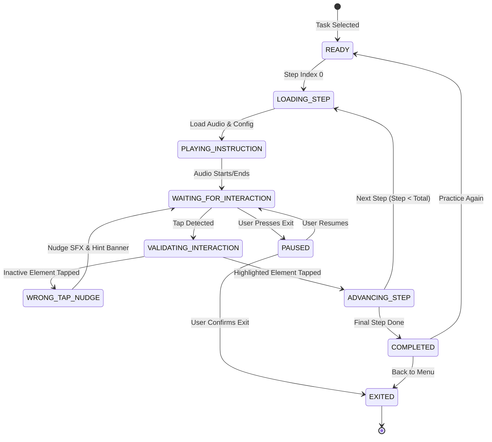
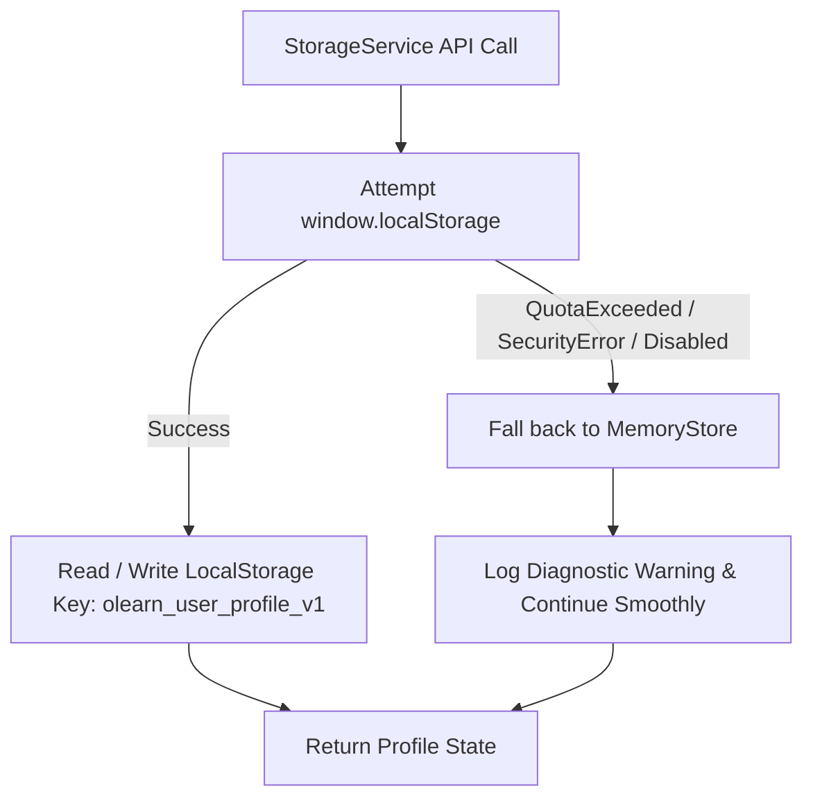
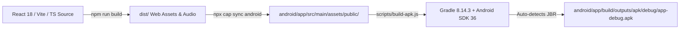

# System Architecture Specification — OLearn

## 1. Architectural Philosophy

OLearn is built on three core architectural principles:
1. **Sandboxed Replicas over Invasiveness**: Rather than attempting OS-level overlays or demanding invasive Android accessibility permissions (`BIND_ACCESSIBILITY_SERVICE`) that pose severe security risks to elderly users, OLearn uses high-fidelity, self-contained interactive replica web components.
2. **Configuration-Driven State Machine**: Curriculum steps, active highlighted elements, voice narration paths, and screen identifiers are declared as pure JSON configurations in `tasks.json`.
3. **Resilient Local-First Topology**: Zero network dependencies for core training. Local persistence, synthesized acoustic audio, offline bundled MP3 narration, and local deterministic intent classification guarantee flawless offline execution.

---

## 2. High-Level System Topology

```mermaid
graph TD
    subgraph Native Android Shell (Capacitor 8)
        WebView[Android WebView / Chrome Engine]
        HardBack[Hardware Back Listener @capacitor/app]
        AssetBridge[Bundled Asset Bridge assets/public/]
    end

    subgraph Core Presentation Layer (React 18 & Vite)
        App[App.tsx Root Router]
        LangScreen[Language Select Screen]
        HomeScreen[Home Dashboard 120dp Tiles]
        SettingsScreen[Settings & Reset Screen]
        AskMeScreen[Ask Me Intent Search]
        TaskEngine[TaskEngine.tsx State Controller]
    end

    subgraph Replicas (Sandboxed Simulators)
        WhatsAppReplica[WhatsAppReplica.tsx Chat/Call]
        GPayReplica[GPayReplica.tsx QR/PIN/Balance]
        HighlightTarget[HighlightTarget.tsx Single-Target Guard]
    end

    subgraph Core Services Layer
        TaskRouterService[TaskRouterService.ts Offline Matcher]
        AudioService[AudioService.ts Player & WebAudio SFX]
        StorageService[StorageService.ts Memory + LocalStorage]
        TaskValidator[TaskValidator.ts Config Schema Guard]
    end

    subgraph Static Data & Assets
        TasksJSON[tasks.json 9 Tasks / 31 Steps]
        AudioFiles[assets/audio/ 93 Pre-bundled MP3s]
        MockData[mockData.ts Sandboxed Fictional Banking]
    end

    WebView --> App
    HardBack --> App
    App --> HomeScreen
    App --> TaskEngine
    App --> AskMeScreen
    App --> SettingsScreen

    TaskEngine --> WhatsAppReplica
    TaskEngine --> GPayReplica
    WhatsAppReplica --> HighlightTarget
    GPayReplica --> HighlightTarget

    TaskEngine --> AudioService
    TaskEngine --> StorageService
    AskMeScreen --> TaskRouterService
    TaskRouterService --> TasksJSON

    AudioService --> AudioFiles
    StorageService --> AssetBridge
    GPayReplica --> MockData
```

---

## 3. Component & Module Breakdown

### 3.1 Presentation & Router (`App.tsx`)
The root component acts as a lightweight screen orchestrator without bloated navigation libraries. It manages top-level view states:
- `language_select`: First-launch onboarding or manual language switch.
- `home`: Main dashboard presenting large tiles for WhatsApp and Google Pay, and header controls (Language, Settings, Ask Me).
- `task_engine`: Active tutorial session rendering `TaskEngine.tsx`.
- `ask_me`: Full-screen modal for speech and typed intent discovery.
- `settings`: Configuration screen for narration speed, mute toggle, and progress reset.

### 3.2 Task Execution Engine (`src/engine/TaskEngine.tsx`)
A deterministic controller driving the tutorial through discrete lifecycle phases.

#### Task Lifecycle State Machine


### 3.3 Target Isolation Guard (`HighlightTarget.tsx`)
Encapsulates all interactive UI elements across both replicas:
- Evaluates if its `elementId` matches the currently active `activeHighlightId`.
- **Correct Tap**: If matched, invokes `onCorrectTap()` after passing a 400ms debounce guard.
- **Wrong Tap**: If inactive, intercepts the tap, stops propagation, invokes `onWrongTap()` to trigger the gentle nudge sound (330Hz $\rightarrow$ 260Hz) and visual feedback banner without penalizing the learner.
- Fully accessible: Renders `role="button"`, `tabIndex={0}`, `aria-label`, and keyboard activation handlers (`Enter` / `Space`).

### 3.4 Replica Sandbox Layer (`src/replicas/`)
- `WhatsAppReplica.tsx`: Replicates chat lists, individual chats, typing keyboards, attachment sheets, gallery picker previews, simulated voice calls, video calls, and voice note recordings.
- `GPayReplica.tsx`: Replicates the Google Pay home screen, shop QR viewfinder, amount entry, masked 4-digit UPI PIN numpad, payment success animations, contact selection, bank balance display, transaction history passbook, and receipts.
  - Every GPay screen embeds the `<SimulationSafetyBanner />` guaranteeing zero confusion with real financial operations.

### 3.5 Offline Intent Router (`src/services/TaskRouterService.ts`)
- Implements deterministic, local-first natural language matching for English, Hindi, and Malayalam.
- Sanitizes queries via `normalizeQuery` (punctuation stripping, case normalization, whitespace collapsing).
- Detects explicit out-of-scope queries (train tickets, food delivery, cabs) and returns localized guidance without failing.
- Disambiguates ambiguous queries (e.g. "call", "pay", "send", "whatsapp", "gpay") into explicit, understandable options.
- Resolves all supported queries to verified task IDs in `tasks.json`.

### 3.6 Resilient Audio Service (`src/services/AudioService.ts`)
- Multi-tier playback engine:
  1. Primary: Bundled local `.mp3` files loaded from `/assets/audio/{lang}/{filename}`.
  2. Dynamic fallback: Web Speech API synthesis on device CPU.
  3. Acoustic SFX: Web Audio API synthesized chimes (zero latency, zero network).
- Audio controls: Play, pause, resume, replay, mute/unmute, and speed rate (`0.8x` slow / `1.0x` normal).
- Safety watchdog: 10-second timeout automatically advances audio state if an audio handle fails or hangs.

### 3.7 Dual-Tier Storage Service (`src/services/StorageService.ts`)

Guarantees the app never crashes even in restrictive browser environments (such as third-party iframe cookies blocked, private mode, or full storage quotas).

### 3.8 Global Font Size Accessibility Controller (`SettingsScreen.tsx` & `StorageService.ts`)
- Manages dynamic typography scaling across the entire application (16sp–30sp range, 20sp default).
- Injects CSS root custom properties (`--olearn-font-scale` and `--olearn-font-base`) into `document.documentElement` dynamically without page reload.
- Persists user preferences to `olearn_user_profile_v1.fontSize` with automatic clamping and memory-store fallback.
- Renders live multilingual sample text preview cards in the active language (English, Hindi, Malayalam) with instantaneous visual feedback.

---

## 4. Data Flow Specifications

### 4.1 Step Progression Data Flow
1. `TaskEngine` reads current step config from `task.steps[stepIndex]`.
2. Triggers `AudioService.playNarration(step.audio_{lang}, step.hint_text[lang])`.
3. Passes `step.highlight_element` down to the active replica component.
4. Active replica renders screen and wraps target element with `<HighlightTarget>`.
5. Learner taps target $\rightarrow$ `HighlightTarget` verifies match $\rightarrow$ calls `onCorrectTap()`.
6. `TaskEngine` plays success chime (D5 $\rightarrow$ A5), debounces for 400ms, and advances `stepIndex + 1`.
7. When `stepIndex === task.steps.length`, marks task complete via `StorageService.markTaskCompleted(taskId)` and plays celebration chime.

---

## 5. Security & Boundary Architecture

- **Android Sandbox**: The Capacitor application runs inside a local WebView pointing to `http://localhost/` or local `android_asset/`.
- **Zero Financial Bridges**: No native banking plugins (`Cordova-plugin-upi` or custom JNI bridges) exist. No real payment intents are registered.
- **Strict Network Isolation**: All core learning assets reside inside the local package.

---

## 6. Native Android Packaging & Automated Build Pipeline



- **One-Command Build**: `npm run android:build` invokes `scripts/build-apk.js`.
- **Automatic JBR Discovery**: Automatically detects Android Studio's bundled Java runtime (`C:\Program Files\Android\Android Studio\jbr`), eliminating manual `JAVA_HOME` configuration hurdles on Windows/macOS/Linux.
- **SDK Target**: Android 16.0 / API Level 36 (`compileSdkVersion = 36`, `targetSdkVersion = 36`, `minSdkVersion = 24`).
- **Hardware Integration**: `@capacitor/app` manages hardware back button interception and app backgrounding audio muting.
