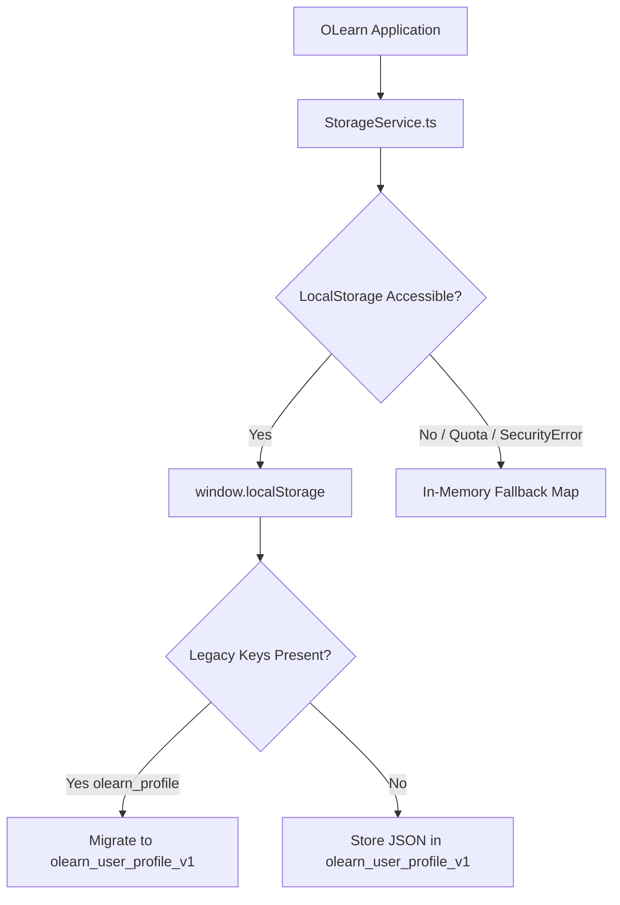

# Persistence Model & Local Storage Specification — OLearn

## 1. Storage Architecture Overview

OLearn follows a **Zero-Cloud, Pure Local-First** data architecture. No external database, Firebase account, SQLite server, or remote sync service is used. All learner preferences and progress are maintained strictly on the learner's physical device.



---

## 2. Key Schema & Model Definition

### 2.1 Canonical Key
All application profile data is saved under a single, versioned localStorage key:
`olearn_user_profile_v1`

### 2.2 TypeScript Data Structure (`AppProfile`)
```typescript
export interface AppProfile {
  language: SupportedLanguage;   // 'en' | 'hi' | 'ml'
  firstLaunchCompleted: boolean; // true once first-launch onboarding is complete
  completedTasks: string[];      // Array of finished task_ids (e.g. ['whatsapp_send_text'])
  speechRate?: number;           // Playback speed (0.8 = Slow & Clear, 1.0 = Normal)
  isMuted?: boolean;             // Audio narration mute toggle
  fontSize?: number;             // Global base font size in sp (16–30, default: 20)
  apiKey?: string;               // Optional user-provided API key for remote LLM
}
```

### 2.3 Example Stored JSON Record
```json
{
  "language": "hi",
  "firstLaunchCompleted": true,
  "completedTasks": [
    "whatsapp_send_text",
    "whatsapp_send_photo",
    "gpay_scan_qr"
  ],
  "speechRate": 0.8,
  "isMuted": false,
  "fontSize": 20
}
```

---

## 3. Schema Migrations & Backward Compatibility

To maintain backward compatibility with legacy prototype versions, `StorageService.ts` automatically executes safe migrations on startup:
1. Checks if `olearn_user_profile_v1` exists.
2. If absent, checks legacy keys: `olearn_user_profile` and `olearn_profile`.
3. If a legacy record is found, it parses the legacy fields, standardizes the structure to `AppProfile`, saves it to `olearn_user_profile_v1`, and removes the deprecated legacy keys.
4. If no profile exists, initializes default values:
   ```json
   {
     "language": "en",
     "hasSelectedLanguage": false,
     "completedTasks": [],
     "speechRate": 0.9,
     "isMuted": false
   }
   ```

---

## 4. Resilience & Error Tolerance Mechanisms

### 4.1 In-Memory Fallback Cache (`memoryStore`)
Web browsers and mobile WebViews can throw exceptions during storage operations:
- `SecurityError`: Occurs in incognito/private browsing mode or when third-party cookies/storage are restricted.
- `QuotaExceededError`: Occurs when device storage is full.
- `DOMException`: Occurs when localStorage is disabled by device security policies.

`StorageService.ts` encapsulates all storage accesses in `safeGetItem`, `safeSetItem`, and `safeRemoveItem`. If `localStorage` throws:
1. It catches the error and logs a diagnostic warning (`console.warn`).
2. It immediately redirects the operation to an in-memory `Map<string, string>`.
3. The application continues running smoothly with zero crashes or broken interactions.

### 4.2 Corrupt JSON Recovery
If `localStorage.getItem` returns malformed JSON (e.g. due to an abrupt device shutdown or external tampering), the `JSON.parse` failure is caught, a clean fallback profile is synthesized, and the corrupt record is gracefully overwritten with valid data.

---

## 5. Security & Privacy Guarantees

- **No Sensitive Data**: No passwords, personal names, phone numbers, banking details, or UPI PINs are ever written to storage.
- **Zero Remote Transmission**: No background synchronization sends the contents of `localStorage` to any remote endpoint.
- **Learner Control**: The learner can wipe all progress at any time via the **Settings $\rightarrow$ Reset Progress** button, which cleanly clears `completedTasks` while preserving language and audio preferences.
